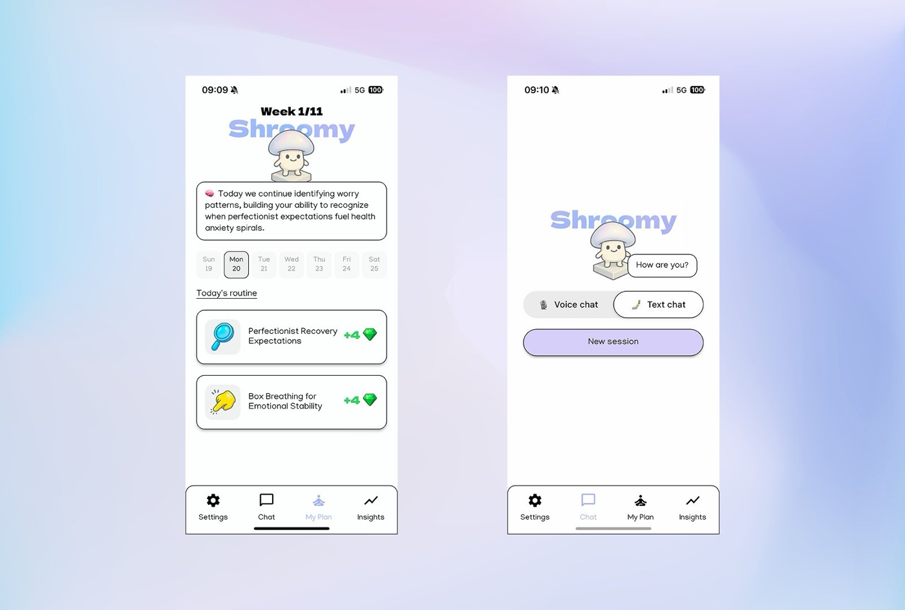
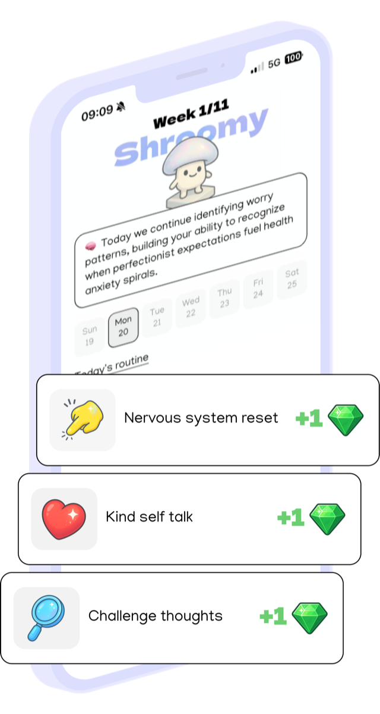
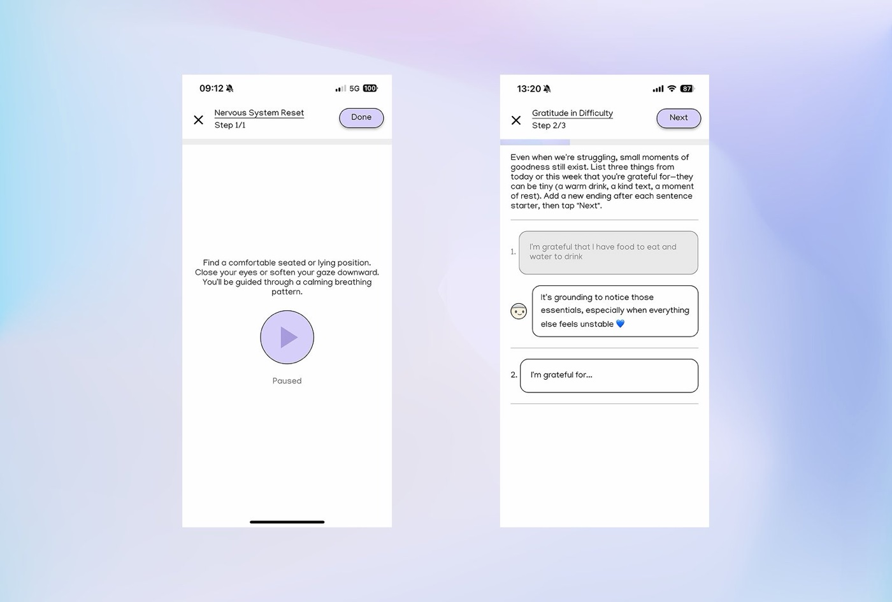
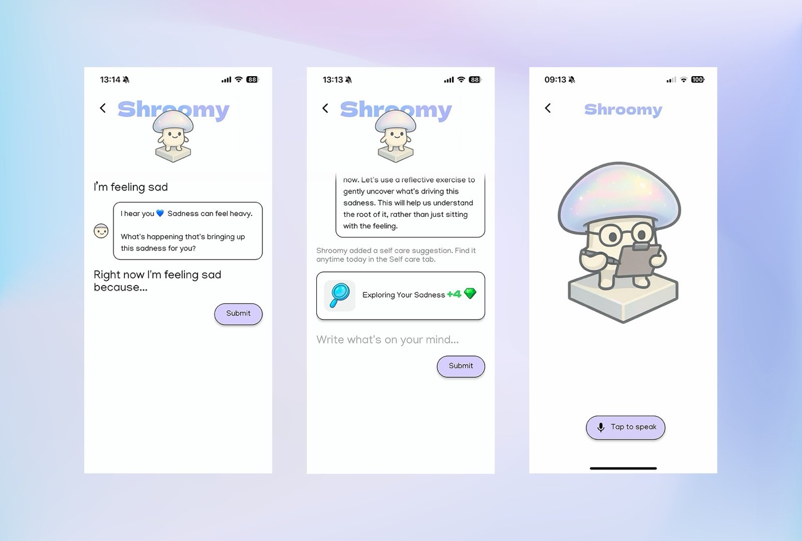
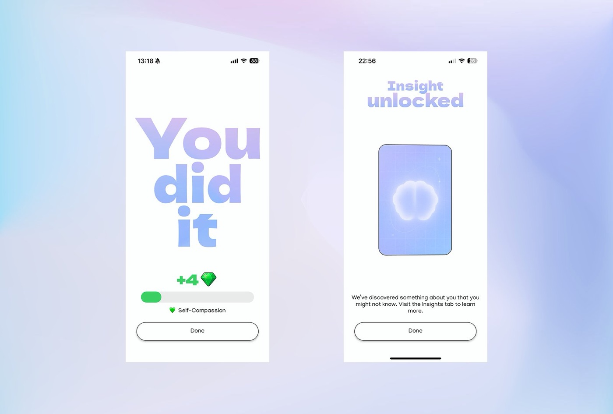
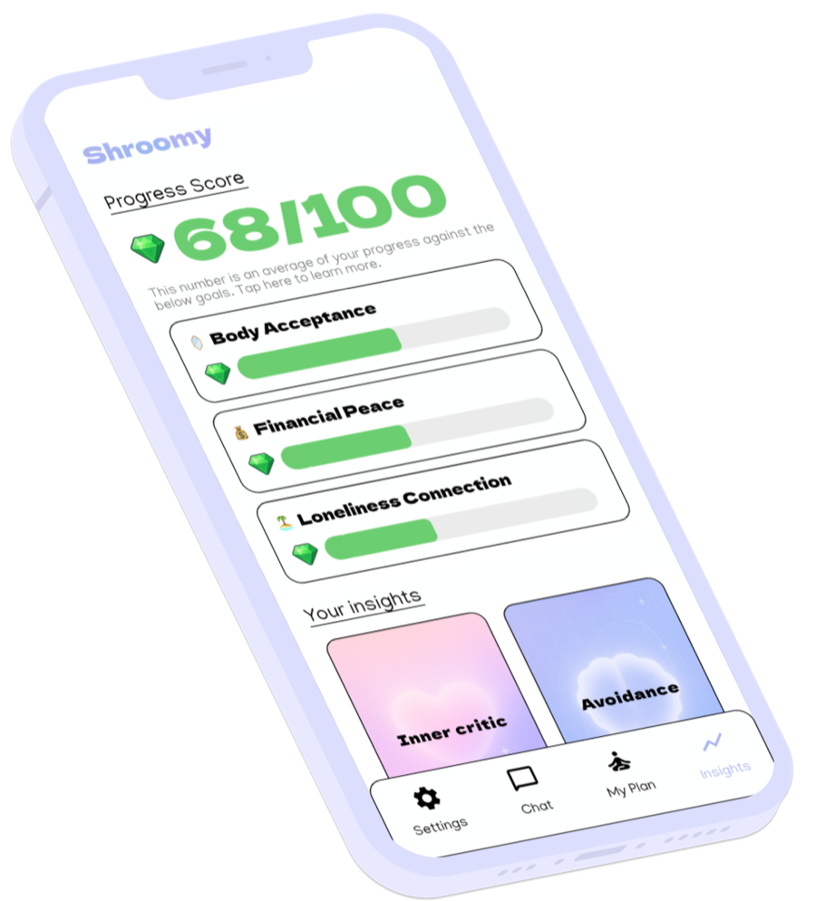

# Shroomy — case study

**An AI anxiety companion for iOS and Android, built and shipped solo.**
A personalised 11-week programme of short daily exercises, a companion you can text or talk to, and guided audio sessions scripted by Claude for each person and voiced with ElevenLabs.

  

| | |
|---|---|
| **What** | Daily, personalised anxiety support: a weekly plan, six exercise formats, text and voice chat, guided audio, progress insights |
| **Platforms** | iOS and Android (Flutter), live on both stores since October 2024 |
| **Role** | Solo founder: product, design, app and backend engineering, prompts, analytics, pricing, support |
| **AI** | Anthropic Claude for reasoning and content, ElevenLabs for speech, OpenAI Whisper for transcription |
| **Scale of the work** | 1,800+ commits, 320+ numbered builds, 130+ hand-written custom actions, an iOS integration test suite in CI |
| **Public signal** | 4.8★ on the App Store from 500+ ratings · 4.8★ on Google Play |

**Links:** [App Store](https://apps.apple.com/us/app/shroomy-daily-stress-relief/id6737152971) · [Google Play](https://play.google.com/store/apps/details?id=uk.co.resetapp.reset) · [shroomyapp.com](https://shroomyapp.com) · [Portfolio](https://www.muhammadib.com/projects/shroomy)

**In this repository:** [Architecture](docs/architecture.md) · [Voice and audio with ElevenLabs](docs/voice-and-audio.md) · [Trade-offs](docs/trade-offs.md) · [Timeline](docs/timeline.md)

> **About this repository.** This is a documentation-only case study. It contains no application source code, configuration, prompts, keys or user data. The screenshots are of the released product and show example content only. The production codebase is private.

---

## The problem

Anxiety improves with consistent practice, but therapy happens once a week at best, and most mental-health apps offer either a generic content library or a chatbot with no structure. Early feedback said the same three things in different words: people did not know what the app wanted from them, it asked the same questions whatever the situation, and they simply forgot to come back.

The bet behind Shroomy was that a programme could be **both** structured and personal. Structure gives people a reason to come back tomorrow. Personalisation, done with a language model that actually remembers what you have told it, makes each day worth coming back to. The friendly mushroom mascot is there to lower the intimidation of a category where trust is the whole product.

## What I built

### A programme, not a library

Every user gets an 11-week programme. Each week has a theme, learning objectives, two behavioural interventions repeated daily for habit formation, and two short exercises a day (3 to 8 minutes each, 15 minutes at most). A progression gate (complete both exercises on at least four days) decides whether the next week unlocks or the current one repeats.

The whole week, 14 fully specified exercises plus the framing around them, is generated in a single structured Claude call, conditioned on the user's psychological profile, four scored focus areas, their memory of past conversations and what they have already done.

  

### Six exercise formats the model must fit into

The most consequential design decision in the product: an AI-generated exercise must be one of six fixed interaction formats, enforced as an enum in the generation schema. The model picks the format and fills the fields; it cannot invent a screen.

| Format | Interaction | Used for |
|---|---|---|
| **Write list** | One prompt, three one-sentence answers with a shared sentence starter | Gratitude, patterns, goals |
| **Write and vent** | Open prompt, free text, a one-minute timer | Emotional release, worry dumping |
| **Questions** | Three questions asked in turn; the second and third are generated live from the answers | Socratic questioning |
| **Reframe** | A short journaling prelude, then three cards: name the pattern, explain it, rewrite the thought, get feedback | Cognitive reframing, or emotional validation when reframing would be wrong |
| **Listen** | A roughly five-minute guided audio session, scripted and voiced for this user | Breathwork, meditation, visualisation, somatic practice |
| **Act** | A brief real-world action and a "mark complete" button | Behavioural activation, exposure, values-based action |

  

### A companion you can text or talk to

Chat is for the moments between exercises. Shroomy acknowledges what you say, asks a clarifying question, and by the third turn must propose a concrete exercise from the six formats, which lands in today's plan. Everything shared is summarised into persistent memory and reused by every later generation.

Voice chat is the same companion, spoken. The user taps to speak, the recording is transcribed, the reply is reasoned by the same model with the same memory and the same safety checks as text, and the answer is voiced by ElevenLabs and streamed back so playback starts before synthesis finishes. The full pipeline is in [docs/voice-and-audio.md](docs/voice-and-audio.md).

  

### Guided audio that is written for one person

Listen exercises are not a library of recordings. When the user opens one, Claude writes a roughly 650-word script in four movements for that person's situation, with pause control for breathing, and ElevenLabs voices it. Breathwork is restricted to two patterns (physiological sigh and box breathing) because longer breath-holds can provoke the very panic the exercise is meant to relieve.

### Progress you can see, and small rewards

Completing an exercise earns points against the focus area it served. Insight cards are generated when there is a genuinely non-obvious pattern to report, held in a queue, and revealed one at a time as a reward for finishing exercises.

  

  

## My contribution

Shroomy was a solo project from first commit to the app stores. I did the product strategy and the pivots, the information architecture and interaction design, the Flutter app and its custom code, the backend functions, the prompt system, the analytics, the pricing and subscription setup, the store listings and the user support.

Two honest notes on tooling. The UI was scaffolded in FlutterFlow and then extended with hand-written Dart: 130-plus custom actions, 13 custom widgets, the audio layer, the safety router and the test suite. And from mid-2025 I directed AI coding agents against written specifications for a share of bug-fix branches, reviewing every change myself. I think of both as leverage, not as substitutes for understanding the system; the two "do not break" specification documents I maintain for the data contracts and the prompts exist precisely so that agents and future me can change the product safely.

## Where the judgment went

A few decisions that I think show how I work. The full list, with the evidence behind each, is in [docs/trade-offs.md](docs/trade-offs.md).

- **Validation mode for the reframing exercise.** Users in real grief or mistreatment reported that a cognitive-reframing flow "tells you you're wrong". I added a runtime mode decision: a first model pass reads the user's own words and commits to either reframing or emotional validation, the screen holds all mode-dependent copy behind a neutral loading state until it does, and in validation mode the labels become emotions, input becomes optional and feedback becomes reflective rather than corrective.
- **Stream the short thing, cache the long thing.** Chat replies are streamed from ElevenLabs through an on-device proxy so speech starts within seconds. Five-minute guided sessions are fetched whole, cached by script hash and de-duplicated across screens, because a pause-and-scrub session is worth a few extra seconds of wait.
- **Deterministic notifications over LLM-written ones.** Notification copy used to be generated per user. I replaced it with a goal-keyed template rotation: a push notification fires whether or not the app is open, so a bad generation is unrecoverable, and reliability beat personalisation on that surface.
- **A safety router that never tells a user they are safe.** For physical-symptom and health-anxiety conversations the router runs a short, user-led self-assessment and escalates only on concrete observable indicators, because both under- and over-escalation harm this population. It ships behind a remote flag, off by default, with an 80-fixture deterministic gate in CI and a manual live eval before any release that touches it.

## Outcomes

**Publicly verifiable**

- 4.8★ on the App Store from 500+ ratings (US storefront, October 2026) and 4.8★ on Google Play.
- Live on both stores since October 2024, through 320+ numbered builds.

**From internal product analytics** (PostHog, 23 January to 28 August 2026; the app launched before analytics were installed, so these are a partial window)

- 92% positive across 6,100+ in-app exercise ratings, shown after completing an exercise, with every one of the six formats between 87% and 96%.
- 81% opt-in at the in-app notification prompt after it was moved from launch to the moment after a completed exercise.
- 97% completion of the day-one feedback conversation that regenerates the rest of the user's first week.
- Roughly one in six reframing sessions routed to validation mode, a rough measure of how many people the old flow would have got wrong.

## Timeline

October 2024 single-session CBT tool → May 2025 Shroomy rebrand and mascot → June 2025 ElevenLabs voice → September 2025 the 11-week programme → February 2026 Spanish, churn survey, pricing experiment, CI test suite → April 2026 validation-mode reframing → September 2026 safety router. Dates and detail in [docs/timeline.md](docs/timeline.md).

---

© Muhammad Bhatti. Shroomy is published by Moment Apps Ltd. This repository is documentation only and is not affiliated with Anthropic, ElevenLabs or OpenAI.
