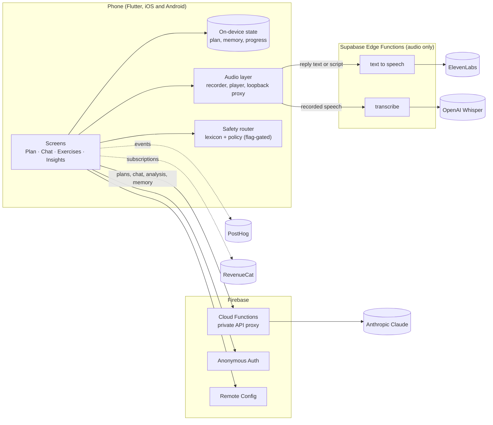
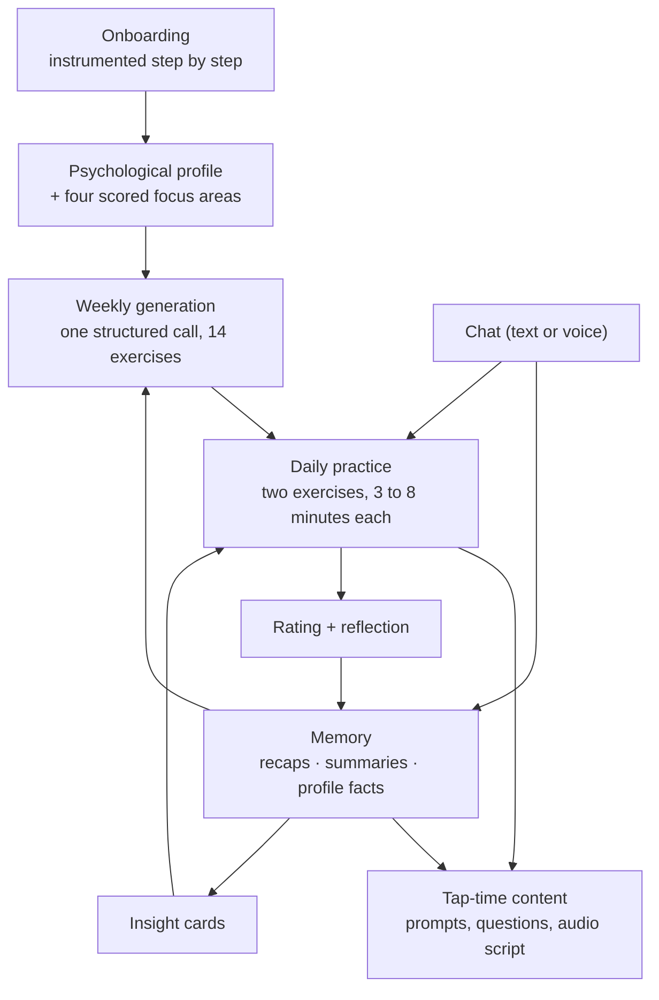

# Architecture overview

Shroomy is a Flutter app with a thin backend. Reasoning goes through Firebase; audio goes through Supabase; user state lives on the device. This page describes the main product and AI components at the level a product or engineering reader needs to follow the rest of the case study.

## System view

**Why this shape**

- **Keys never ship in the app.** Every model call is made server-side. Claude calls go through a private Firebase Cloud Function; speech calls go through Supabase edge functions. The app only ever holds a short-lived Firebase ID token, which it attaches to every audio request alongside the public Supabase key.
- **Users get an identity without an account.** Users are authenticated anonymously with Firebase by default, so there is a stable identity for the backend without a sign-up form.
- **The primary store of truth is the phone.** Plan, memory, progress and preferences are persisted locally as JSON. This was a deliberate privacy posture in a category where people volunteered privacy objections unprompted, and it is what the store listing promises.
- **Feature flags live in Remote Config.** The safety router and other sensitive behaviour can be turned on for internal testers first.

## The AI components

| Capability | Provider | How it is used |
|---|---|---|
| Weekly programme generation | Claude (Sonnet class) | One structured tool call returns the theme, objectives, focus areas, two daily interventions and all 14 exercises for the week |
| Tap-time exercise content | Claude | Prompts, sentence starters, questions and audio scripts are generated when the user opens an exercise, from a lightweight skeleton planned at week level |
| Chat companion | Claude, with prompt caching | Free-form conversation that must propose an exercise by the third turn through a tool call; the proposal lands in today's plan |
| Reframe analysis and feedback | Claude | A two-phase call: the first pass returns one card and commits to a mode (reframing or validation); the second pass fills the remaining cards in the background |
| Memory | Claude | Conversations and exercise inputs are summarised into daily recaps, weekly consolidations and profile facts, which feed every later prompt |
| Insight cards | Claude | Generated only when the model can identify a genuinely non-obvious pattern, de-duplicated against earlier cards, revealed one at a time |
| Day-one feedback | Claude | A short conversation after the first day regenerates days two to seven of the plan, inside an explicit list of what the system can and cannot change |
| Safety classification | Claude (Haiku class) | A small server-owned classifier behind a deterministic lexicon; see below |
| Speech-to-text | OpenAI Whisper | Transcribes voice-chat recordings |
| Text-to-speech | ElevenLabs | Voices chat replies (streamed) and guided audio sessions (generated, then cached). Detail in [voice-and-audio.md](voice-and-audio.md) |

## The content pipeline

Three things make this loop work in practice:

1. **A closed action space.** Every exercise declares one of six interaction formats and the fields that format requires. The schema is enforced in the tool definition and re-validated in the app, so a prompt change can never break a screen.
2. **Layered context.** Each generation call sees the profile, the focus areas with their scores (lower score, higher priority), recent memory, the user's own past exercise inputs, the themes of every completed week (so nothing repeats), and the intervention types the user asked to avoid during onboarding.
3. **Defensive parsing.** Model output drifts. A normalisation layer coerces types, maps near-miss keys, defaults missing fields and retries once before showing a retry state. A concurrency flag prevents duplicate week generation when a screen is re-entered.

## Personalisation substrate

The memory object has five parts, each with a defined lifecycle:

- **Daily recaps**: a short summary per check-in; same-day updates are appended, not overwritten.
- **Weekly consolidations**: every seven recaps are folded into one summary and the sources marked as consumed.
- **Profile facts**: biographical facts with a last-mentioned date, upserted case-insensitively.
- **Exercise recaps**: what the user actually wrote, used to enrich the next prompt.
- **Task status**: completion and like state per exercise.

Localisation respects this. Display strings are localised (English and Spanish), but every stored onboarding answer is reverse-mapped to its canonical English value before it is saved, so localisation never degrades the quality of what the model is given.

## The safety router

Built in September 2026 behind a remote flag that is **off by default**. Before any generation in text chat, voice chat and the reframing exercise, the user's turn is classified into one of four levels. A narrow deterministic lexicon catches explicit acute phrases with no model call; a small classifier handles the rest, and a classifier failure never yields the lowest level.

The policy changes what the screen is allowed to do: deterministic panels for acute turns (no generation at all), a boundary line and constrained generation for medication and diagnosis questions, a short user-led self-assessment for physical-symptom turns, forced validation mode for the reframing exercise on sensitive content, and a hard invariant that acute text never re-enters a later model request. Copy is checked by tests for certainty claims and emergency vocabulary. Telemetry is allow-listed; free text cannot be emitted.

Quality gates: a unit and fixture tier (80-plus fixtures) runs on every pull request with no network; a live tier runs the real classifier and generation by hand before any release that touches safety paths. None of this is clinically validated, and the product never says so.

## Quality and release

- An iOS integration test suite (16 tests) runs in GitHub Actions on every pull request: four onboarding variants, trial to home, all exercise formats, three completion paths, chat, navigation and state.
- A visual QA walkthrough drives the real app screen to screen and captures each one for review.
- Crash reporting, generation telemetry (phase, attempt, latency, error type) and per-format satisfaction ratings in PostHog.
- 320-plus numbered builds across both stores.
