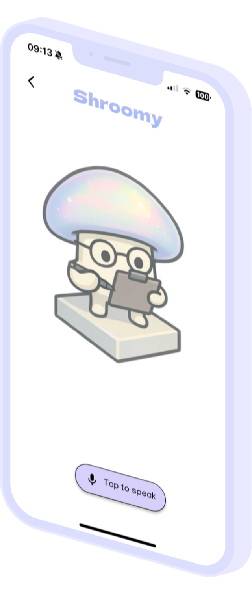
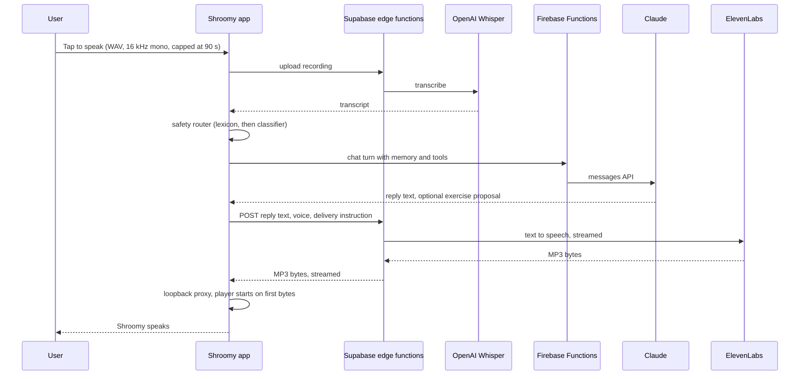
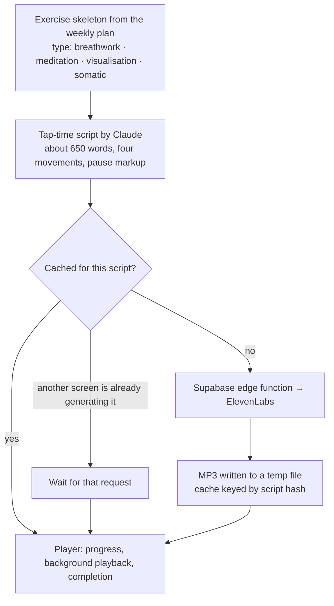

# Voice and audio: how ElevenLabs powers Shroomy

ElevenLabs is the voice of the product. It speaks in two places that need different engineering:

1. **Voice chat**: short conversational replies where the first second matters.
2. **Guided audio exercises**: five-minute sessions written for one person, where reliability and scrubbing matter more than the first second.

Both run through small Supabase edge functions that hold the ElevenLabs key, authenticate the caller, and forward the text. The app never talks to ElevenLabs directly.

  
  &nbsp;&nbsp;&nbsp;
  

## 1. Voice chat

Voice chat is the text companion, spoken. That is a design decision, not a shortcut: the voice surface shares the same model, the same memory, the same exercise-proposal tool and the same safety router as text chat, so nothing the product has learned about a person is lost when they switch modes.

**What the app does with the stream.** Mobile audio players want a URL they can seek in; ElevenLabs gives back a stream of bytes. The app bridges the two with a tiny HTTP server on the loopback interface, running in its own isolate. The server tapes every byte it has received, serves new requests from the tape first and then live from the stream, and honours `Range: bytes=n-` requests so that when iOS re-probes a long track it resumes from the right place instead of restarting the clip. The result is that the first audible words arrive while ElevenLabs is still synthesising the end of the sentence.

**Failure handling.** The request is retried up to three times with a short back-off, with errors classified (server, auth, network, player) so that only the retryable ones retry. UI state moves through "loading", "playing" and "ready for input" explicitly, so the microphone button and the waveform always reflect what is really happening.

**Safety in voice.** Voice has no buttons, so a safety decision that would show a panel in text is spoken instead, and acute turns are handled conservatively. Health-anxiety assessments run the same state machine as text.

## 2. Guided audio exercises

A Listen exercise is scripted and voiced on demand, for one person, at the moment they open it.

**The script.** A type-specific prompt (breathwork, meditation, visualisation, somatic, other) writes roughly 650 words in four movements, always starting by meeting the person where they are today, using their profile, recent memory and today's conversation. Pauses are expressed as speech markup with a hard cap of three seconds per pause, no chained pauses, and 15 to 25 pauses per session. Breathwork is limited to two patterns, physiological sigh and box breathing, with a maximum of three to four main cycles. The 4-7-8 pattern is banned: a seven-count hold can provoke air hunger and panic in exactly the people this product serves.

**The voice.** Users choose a male or female voice the first time they open an audio exercise, and can change it later from settings. Spanish-language users are routed to Spanish-capable voices automatically. When I changed the default female voice, existing users were migrated once on next launch so nobody heard the voice change mid-programme.

**Why fetch whole rather than stream here.** A five-minute session is something people pause, scrub and sometimes background. Fetching the complete file and playing from local storage gives reliable seeking, lock-screen controls and no mid-session stalls on a weak connection. The cost is a wait before playback, which the next three decisions address.

- **Cache by script hash.** Re-opening an exercise, or re-entering after an interruption, plays instantly.
- **De-duplicate in flight.** If two screens request the same script, the second waits for the first instead of paying for a second synthesis.
- **Survive backgrounding.** If the phone locks while the audio is still being fetched, the app asks iOS for about thirty seconds of background execution so the download completes, and retries on resume if it did not.
- **An honest progress bar.** The loading bar eases towards 95% over a target of about twenty seconds, tuned to the Turbo model's real generation time, so the wait feels bounded rather than indeterminate.

## Why ElevenLabs, and how it got here

Shroomy's first audio path, in early 2025, voiced scripts with OpenAI's text-to-speech through a Firebase function that returned a single base64 blob. Over spring 2025 I experimented with chunked streaming through Supabase and briefly with a real-time speech-to-speech relay. In June 2025 I moved both voice surfaces to ElevenLabs behind two new edge functions, one for streamed chat replies and one for whole-file audio sessions, and that is the architecture in production today.

Three reasons, in order of weight:

1. **Expressiveness.** A guided breathing session lives or dies on pacing and warmth. ElevenLabs' voices and pause control made scripts sound like a person leading you, not a screen reader.
2. **Latency.** The Turbo model family made a five-minute session arrive in about twenty seconds and a chat reply start in a few, which is what makes streamed voice chat feel conversational rather than turn-based.
3. **Voice as a product surface.** Male and female voices, Spanish-capable voices, a one-time voice migration, and a delivery instruction passed with every chat reply all became ordinary product levers rather than engineering projects.

## Where I would take it next

- **Stream the long sessions too.** Now that the loopback proxy exists for chat, the same mechanism could start a guided session on the first sentence, with the whole-file path kept as the cache.
- **Word-level timing.** Timestamps alongside the audio would allow on-screen captions and a breathing visual that follows the voice exactly.
- **An agentic voice session.** The transcribe-reason-speak pipeline keeps full control over memory, tools and safety, at the cost of turn latency. A conversational-agent approach would be worth testing for the moments where that latency hurts most, as long as the safety router keeps the final say.
